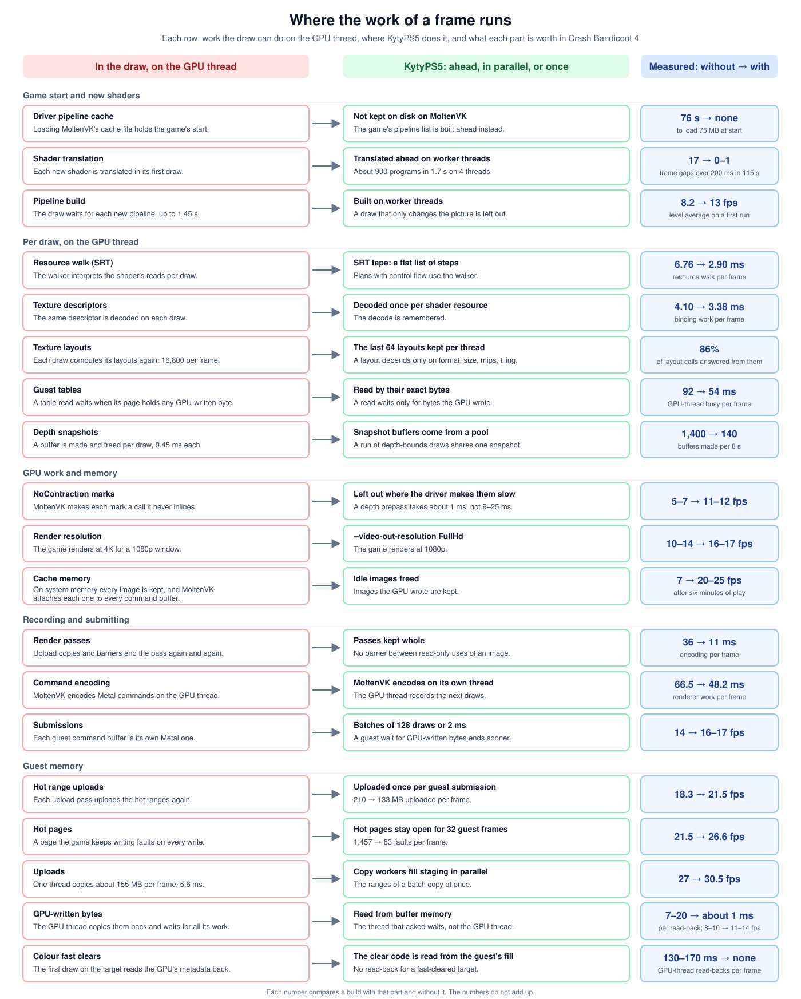
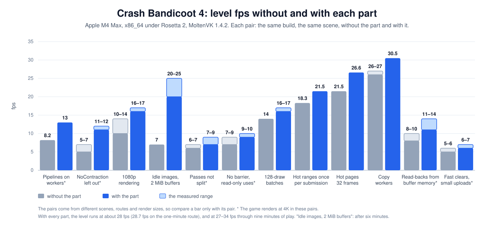
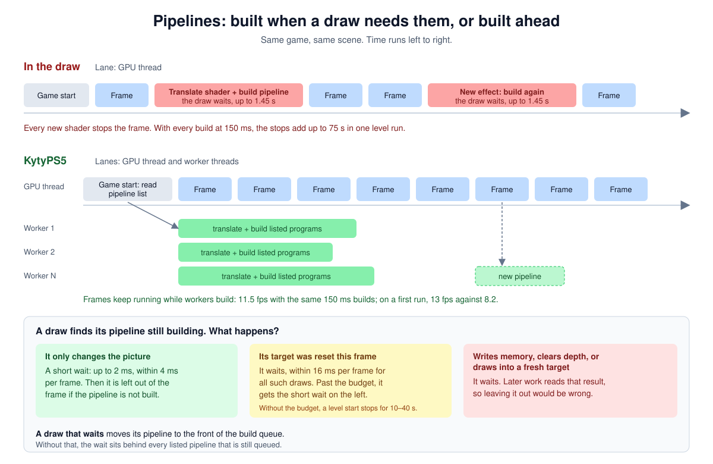
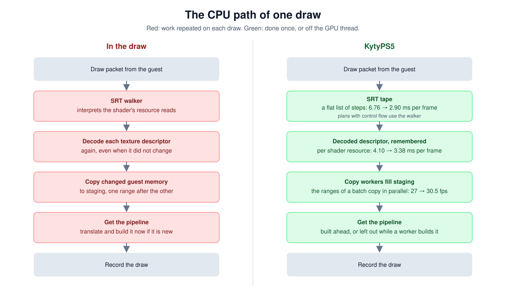

# Performance

KytyPS5 keeps the GPU thread free to record draws.
Work that would hold a draw runs ahead of it, on other threads, or once for many draws.
Each diagram puts the simple way, where the draw does the work on the GPU thread, next to the way KytyPS5 does it.

The numbers come from Crash Bandicoot 4 on an Apple M4 Max (x86_64 under Rosetta 2, MoltenVK 1.4.2).
Each number compares a build with one part and the same build without it, in the same scene.
The scenes, routes and render sizes differ between parts, so the numbers do not add up.
With every part, the level runs at about 28 fps (28.7 fps on the one-minute route).

## Overview

Each row is one part: the work the draw would do on the GPU thread, where KytyPS5 does it, and what the part is worth.

## Frame rate without and with each part

Each pair of bars is one part: the level fps without it and with it.
Compare a bar only with its pair. In the pairs marked with *, the game renders at 4K; in the others at 1080p (`--video-out-resolution FullHd`).

## Pipelines built ahead

Each game has a pipeline list in the cache folder.
At start, worker threads translate the listed programs and build their pipelines.
A pipeline that is not in the list is built on a worker, and the list keeps it for the next run.

A draw whose pipeline is still building:

- waits when it writes memory, clears depth, or draws into a fresh target;
- waits up to 16 ms in each frame, for all such draws together, when its target was reset in that frame (cleared or overwritten, other than by a draw);
- otherwise waits up to 2 ms, within 4 ms in each frame, and is left out of the frame when the pipeline is still not built.

A draw into a reset target that runs out of its 16 ms budget gets the short wait as well.
A draw that waits moves its pipeline to the front of the build queue, so it does not wait behind the listed pipelines.

## The CPU path of one draw

- **SRT tape.** A resource plan without control flow runs its SRT reads (the shader resource table) as a flat list of steps. Plans with control flow use the walker. The resource walk takes 2.90 ms per frame, against 6.76 ms with the walker alone.
- **Texture descriptors.** A decoded descriptor is remembered per shader resource: binding work takes 3.38 ms per frame, against 4.10 ms.
- **Uploads.** Copy workers copy guest bytes into staging buffers in parallel: 30.5 fps, against 26–27 fps with one thread.
- **Pipelines.** A pipeline is built ahead. A draw that only changes the picture gets a short wait, then is left out while a worker builds its pipeline.

## Also

- **Waits for the GPU.** Submissions are planned. Fences retire resources after the queue, and a resource is destroyed only when every queue commit that holds it completes.
- **Cache memory.** MoltenVK attaches every live resource to every command buffer, so unused images cost GPU time.
  The caches collect when the device memory in use reaches a trigger derived from the memory budget.
  On a GPU that uses the system memory, the texture cache also runs idle passes: they free images unused for 1,000 passes and keep the images the GPU wrote.
  A pass runs once for each completed guest submission.
  A pass for memory can also free images the GPU wrote.
  See `src/graphics/host_gpu/cacheCollection.h`.
- **Frame cost.** `--perf-counters` prints what a frame costs: draws, dispatches, uploads and copy regions.
